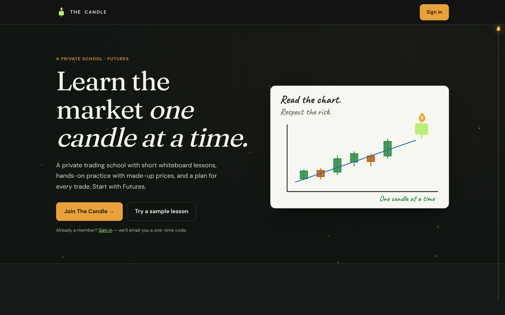
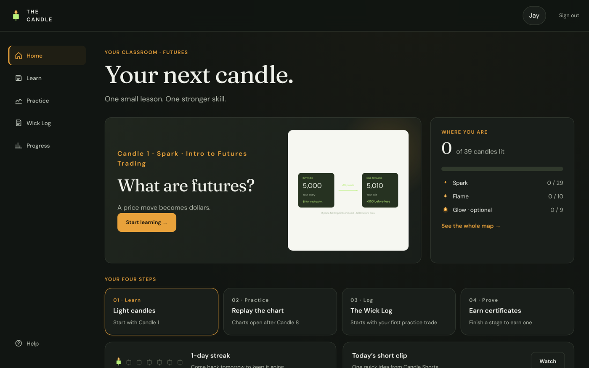
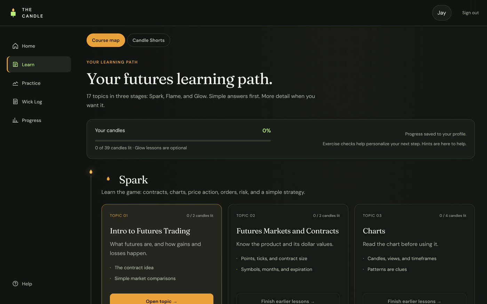
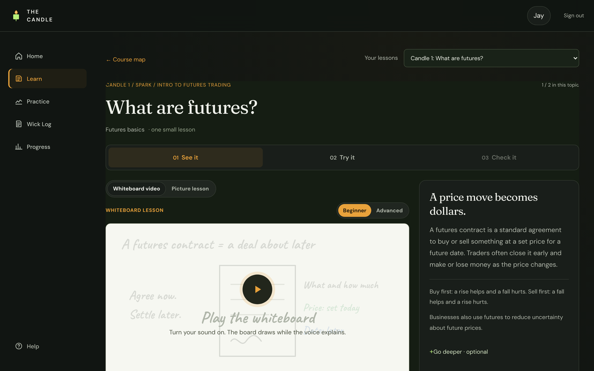
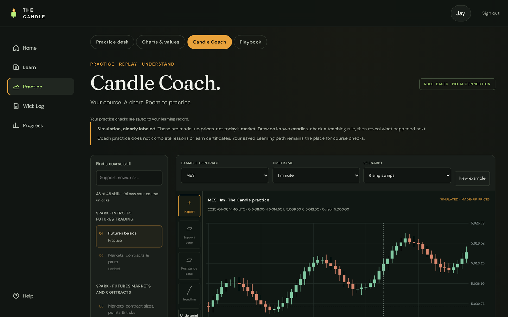
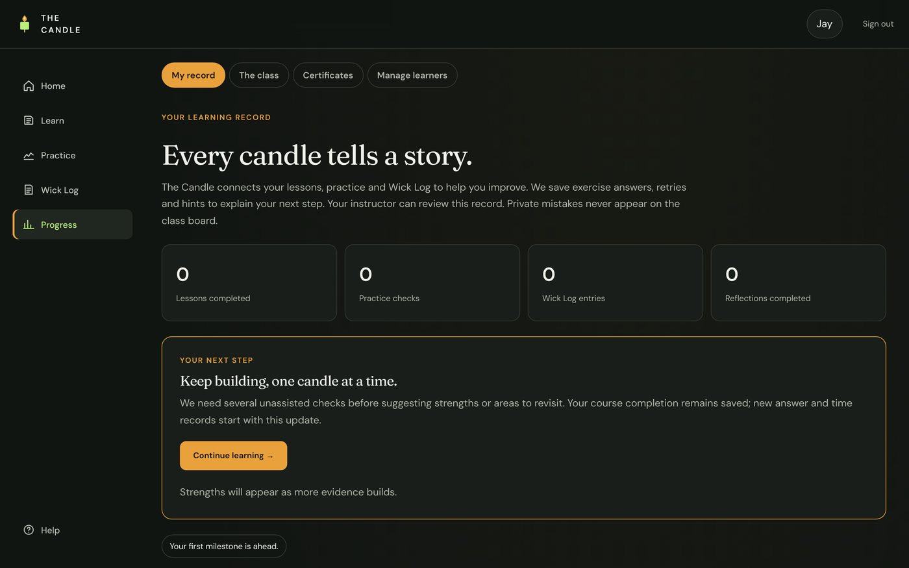
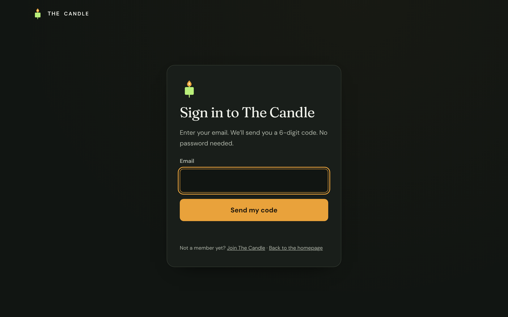
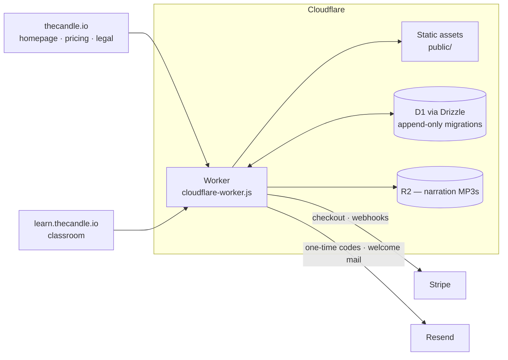

# The Candle — a trading school built like a product

<p align="center"></p>

<p align="center"><a href="https://thecandle.io"><b>thecandle.io</b></a> · public homepage with a live sample lesson · private classroom at <code>learn.thecandle.io</code></p>

The Candle is a beginner-friendly futures-trading school I built from scratch: 48 animated whiteboard lessons with narration, a hands-on practice desk that replays made-up charts, a private trade journal, progress tracking, certificates, and Stripe memberships. It started as a site for friends I was teaching to trade; it is now launching to the public with a 7-day free trial.

The teaching rule behind it — *one idea, one candle at a time; simple answer first, "go deeper" optional* — is also the engineering rule: every lesson is See → Try → Check, every check is server-validated, and nothing in the app ever places a real order.

This repo is a **curated public subset** of the private `the-candle` codebase (≈1 MB of JavaScript, 27 test files, 40 commits). It contains the pieces that show how it's built — sign-in, billing, the host-splitting Worker, the schema, the P/L model and one whiteboard lesson — plus screenshots of the real classroom.

## What a learner sees

| Classroom home — "your next candle" | Course map — Spark · Flame · Glow |
|---|---|
|  |  |

| A lesson: whiteboard video, Beginner/Advanced, See → Try → Check | Practice desk — Candle Coach replays made-up charts |
|---|---|
|  |  |

| Learning record | Sign-in — email code, no password |
|---|---|
|  |  |

## Architecture



**One Worker, two hosts.** `cloudflare-worker.js` runs first on every request (`run_worker_first = true`). `thecandle.io` may only serve the public homepage, pricing and legal pages; `learn.thecandle.io` serves the classroom and refuses everything — pages, assets, API, audio — without a valid session. There is no `workers.dev` hostname and no preview URL.

**Passwordless sign-in built in-house (`src/auth.js`).** Rather than use a hosted login that didn't match the brand, the school has its own: a 6-digit code emailed via Resend, stored only as a keyed hash, 10-minute expiry, 5 guesses, rate limits per email (3 / 15 min, 10 / day) and per network, and a 256-bit session token in a `__Host-` HttpOnly cookie with only its hash in the database. Who may sign in is a data question: the owner, invited learners, and anyone whose Stripe membership is active.

**Billing without an SDK (`src/billing.js`).** Monthly (subscription with a 7-day trial) and Lifetime (one-time) plans go through Stripe Checkout; the Worker calls Stripe's REST API over plain `fetch`, verifies webhook signatures itself with a tolerance window, and treats checkout completion and the webhook as idempotent — whichever arrives first creates the membership and learner profile. `past_due` keeps access during Stripe's retry window.

**Schema as code (`src/db/schema.ts`).** Drizzle ORM with generated, append-only migrations — the deployed migration is never edited. Learner identity, per-course progress, journals, login codes, sessions, memberships and auth events each have their own table; writes are user-scoped and server-recomputed.

**Teaching engine.** Each lesson is a scene file (`src/whiteboard/candles.js` is one) built from a tiny drawing DSL (`src/whiteboard/draw.js`): text, lines, arrows, candles, rings, paths, each with a start time, plus beginner and advanced narration. The player draws the board while the voice plays. The P/L model (`src/model.js`) is the single source of truth for every calculator and simulator: it validates tick increments, contract limits and fees before it computes anything.

**Media on the edge.** Narration clips live in R2 and are served through the Worker with byte-range support (Safari needs it), only to signed-in learners.

## Testing

The private repo runs 27 test files with `npm test` — unit suites against an in-memory D1 adapter (144 P/L scenarios, curriculum ordering, auth, billing, certificates, coach, playbook, leaderboard, shorts) and a Chromium suite that walks 102 prerequisite lessons with real interactions and checks four viewport widths for overflow. Two of the unit suites are included here.

## What's in this repo

```
src/
  cloudflare-worker.js   production entry — host split, auth gate, audio ranges
  auth.js                email-code sign-in, sessions, rate limits
  billing.js             Stripe checkout, webhooks, membership access rule
  model.js               contract table + P/L calculation with validation
  db/schema.ts           Drizzle schema
  whiteboard/draw.js     the drawing DSL
  whiteboard/candles.js  one complete whiteboard lesson
tests/                   auth and billing suites
wrangler.toml            bindings and routing (IDs redacted)
docs/                    screenshots
```

For reading, not running — the files import siblings that stay in the private repo.

## Stack

Cloudflare Workers · Workers Static Assets · D1 + Drizzle ORM · R2 · Stripe · Resend · ElevenLabs narration · esbuild · Node test runner + Playwright/Chromium · vanilla HTML/CSS/JS

---

**Jaami Hasan** · [jaamihasan.com](https://jaamihasan.com) · [LinkedIn](https://www.linkedin.com/in/jaamihasan) · [GitHub](https://github.com/yungking304)
